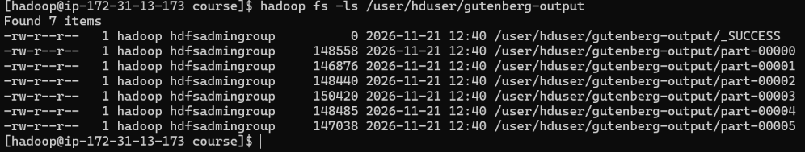
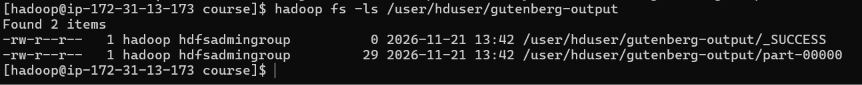

# Hadoop MapReduce Lab

## Exercise 1

**First run (default reducers):**
- Launched map tasks: 9
- Launched reduce tasks: 3
- Merged Map outputs: 27

**Second run (`-numReduceTasks 6`):**
- Launched map tasks: 9
- Launched reduce tasks: 6
- Merged Map outputs: 54

**Q1. How many files are there now?**
A1. There are 7 items total in `/user/hduser/gutenberg-output`: 6 output partition files (`part-00000` through `part-00005`) and 1 `_SUCCESS` status file.

**Q2. Did number of mapper change?**
A2. No, it stayed at 9. The number of map tasks is determined by the HDFS input splits (9 splits across the 3 input files), not by the `-numReduceTasks` parameter.

**Q3. Did number of reducer changed?**
A3. Yes, it changed from 3 (the default) to 6 because we explicitly specified `-numReduceTasks 6`.

**Q4. Did number of output files change? Why?**
A4. Yes, the total items in the output directory increased from 4 (3 part files + `_SUCCESS`) to 7 (6 part files + `_SUCCESS`). Each reducer task writes its own separate output partition file (`part-00000`, `part-00001`, etc.), so increasing the number of reducers from 3 to 6 produces 6 output part files instead of 3.

**Q5. What does the value of 'Merged Map outputs' represents and how is it calculated?**
A5. It represents the total number of map output partitions fetched and merged across all reducers during the shuffle and merge phase. Each mapper partitions its output into one bucket per reducer, so every reducer fetches and merges one partition from each mapper:
- `Merged Map outputs = (Launched map tasks) * (Launched reduce tasks)`
- First run: `9 * 3 = 27`
- Second run: `9 * 6 = 54`



---

## Exercise 2

The main change goes in `mapper.py`. Because `mapper.py` reads raw lines, splits them into words, and emits `(word, 1)` pairs, stripping trailing commas/dots (`,.`) and lowercasing (`.lower()`) right when each word is processed ensures identical normalized keys reach the shuffle/sort and reducer cleanly, so `reducer.py` stays unchanged.

---

## Exercise 3

The main change goes in `reducer.py`, since only the reducer receives all counts for each word and can rank the totals across the dataset (and with `-numReduceTasks 1`, one reducer produces the final top 3).



### Top 3 Most Frequent Words

**Raw Output (`part-00000`):**
```text
the	74369
and	42768
of	34588
